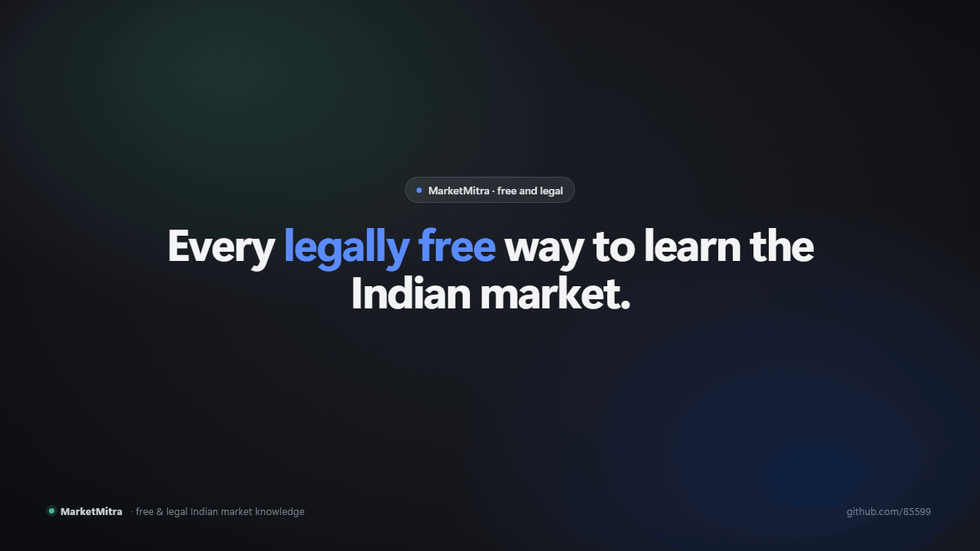

<h1 align="center">MarketMitra — the free Indian stock-market library</h1>

<p align="center">
  <b>2,606 legally free resources. English + हिंदी. No login, no ads, no pirated PDF.</b><br>
  <a href="https://85599.github.io/MarketMitra-Learn/"></a>
  <a href="https://github.com/85599/MarketMitra-Learn"></a>
  <a href="https://in.tradingview.com/u/khushaljain023/"></a>
</p>

<p align="center">
  
  
  
  
  
</p>

<p align="center">
  <a href="https://85599.github.io/MarketMitra-Learn/"></a>
  <br>
  <sub>80 seconds, start to finish · same walkthrough as a 1280×720 MP4: <a href="https://85599.github.io/MarketMitra-Learn/assets/demo.mp4">demo.mp4</a></sub>
</p>

**One click, then it just works:** <https://85599.github.io/MarketMitra-Learn/> — clone it, host it anywhere, or open `index.html` straight from your file manager. It is a plain static site: no server, no framework, no account, nothing to install.

---

## The problem this solves

Learning the Indian market online is a scavenger hunt with three failure modes:

| What usually happens | Why it hurts |
| --- | --- |
| A "free PDF" is a pirated scan | It vanishes in a week, and it is not yours to read |
| The good course is behind a ₹15,000 paywall | You either overpay or never start |
| The free stuff is real but scattered | Zerodha Varsity here, an RBI PDF there, a Damodaran lecture somewhere else, 40 open tabs, no order |

**MarketMitra is the index instead of the scavenger hunt.** Every entry links to the publisher's own free copy — regulator, exchange, university, author or the company itself — so nothing dies from a takedown, and nothing you open is stolen work.

## What you actually get

| Section | What it is | Size |
| --- | --- | --- |
| **Library** | Books, PDFs, notes, courses, videos, papers and tools. Filter by type, region, language, cost, difficulty and "no signup needed". Search matches real titles. | **2,606** entries · 41 sources |
| **Knowledge** | Written explainers on fintech, macro, taxation, options, financial statements and behaviour — not links, actual content, in both languages | 24 topics |
| **Paths** | Ordered tracks that tell you what to open next, with progress saved on your device | 4 paths |
| **Calculators** | Real maths, shown as bars and formulas, with a note on what the number does *not* include | 10 tools |
| **Self-check** | Quiz tracks with instant explanations, shuffled options, keyboard answers, a review list of what you missed, best scores kept | 10 tracks · 80 questions |
| **Glossary** | Plain-language terms, one line in English and the next in हिंदी | 87 terms |

**The 10 calculators:** SIP & lump-sum compounding · SWP (safe monthly payout from a corpus) · Goal → monthly SIP · Inflation-adjusted growth · Loan EMI and interest cost · All-in intraday trade cost · Capital-gains tax (STCG/LTCG) · Position size from risk · Futures margin and leverage · Loss recovery and volatility drag.

**The 10 quiz tracks:** First investments · Trading safely · Fintech & payments · Global markets & valuation · Futures & options · Financial statements · Macro, rates & inflation · SEBI, rights & redressal · Behaviour & traps · Personal finance & tax — plus a **Mixed challenge** that pulls one question from every track.

## Who it is for

- **The first-Demat-account person** who wants a real sequence instead of random reels.
- **The trader** who needs position size, trade cost, leverage and drawdown maths in seconds, not in Excel.
- **The long-term investor** comparing SIP, SWP, goal funding and what inflation actually does to the number.
- **The हिंदी-medium learner** — the whole site, including calculators and quizzes, flips language with one click.
- **The educator / Telegram-group admin** who needs a link that is safe to share because every source is legally free.

## Why it is better than the alternatives

- **Nothing is paywalled or pirated.** Only sources that are free by the publisher's own intent. No Drive links that expire, no scanned books.
- **Bilingual by design, not bolted on.** Titles, descriptions, calculators, quiz questions, glossary and UI strings all ship in EN and हिंदी.
- **Zero footprint.** No login, no cookie banner, no analytics, no ads. Language, theme, saved shelf and quiz scores live in `localStorage` and never leave the browser.
- **Zero dependencies, zero build.** Vanilla JS and one CSS file. `index.html` works from `file://` — you can put it on a pen drive.
- **Everything is one click deep.** Every capability has a visible control: chips, toggles, keyboard `1–4` in quizzes, a save star on every card.

## Run it locally

```bash
git clone https://github.com/85599/MarketMitra-Learn.git
cd MarketMitra-Learn
# either: double-click index.html  (works offline, file://)
# or:     python -m http.server 8000   → http://localhost:8000
```

No `npm install`, no bundler, no environment variables.

## Editing the data

The catalogue is plain JS, so it is editable without any tooling:

| File | Holds |
| --- | --- |
| `data.js` | UI strings (EN + हिंदी), curated resources, topics, paths, glossary |
| `data-tools.js` | The 10 calculator specs and their rates |
| `data-quiz.js` | The 10 quiz tracks, 80 questions and difficulty tags |
| `data-bulk.js` | The bulk catalogue (books, PDFs, notes, videos, papers) |
| `app.js` | Rendering, filters, search, calculators, quiz engine, i18n |

Add an object to the right array, reload the page. Every URL in the catalogue was checked against the publisher before it was added; keep it that way when you contribute.

## Legal note

This project indexes **freely available, legally published** material and links to the publisher's own page. It hosts no copyrighted books, no leaked PDFs and no paid course content, and it is not investment advice. If you own a listed resource and would rather it not appear, open an issue and it will be removed.

## Connect

- Code and data: <https://github.com/85599>
- Chart ideas and Pine Script indicators on NSE/BSE: <https://in.tradingview.com/u/khushaljain023/>
- Live site: <https://85599.github.io/MarketMitra-Learn/>

License: MIT · Made by **KHUSHAL JAIN**

---

<p align="center">
  <b>If this saved you forty open tabs, a ⭐ on the repo helps the next learner find it.</b><br>
  <sub>#StockMarket #IndianStockMarket #NiftyBankNifty #Sensex #NSE #BSE #ZerodhaVarsity #MutualFunds #SIP #Investing #Trading #PersonalFinance #FinancialLiteracy #Fintech #UPI #SEBI #RBI #OpenSource #GitHubPages #FreeCourses #Hindi #Learning</sub>
</p>
